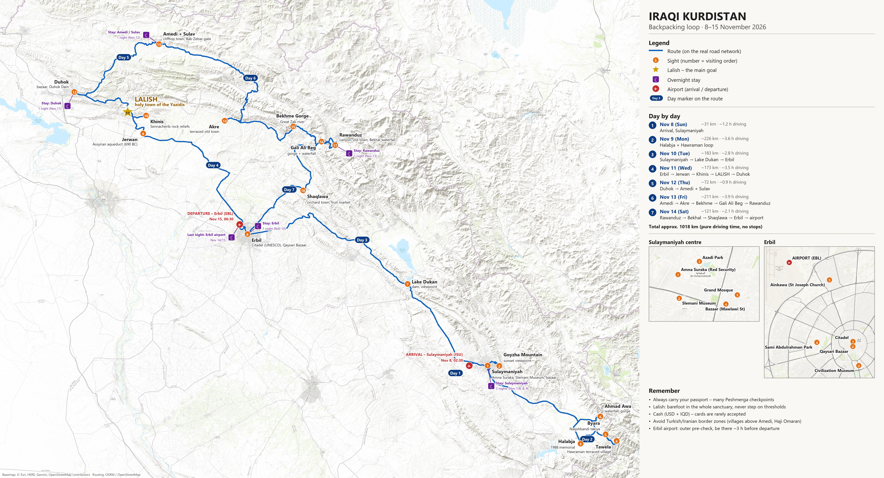

# Iraki Kurdisztán – hátizsákos körút (2026. nov. 8–15.)

**Térkép:** [Irak_utvonal_terkep.png](Irak_utvonal_terkep.png) (7591×4113 px, nagyítható) · kisebb fájl: [Irak_utvonal_terkep.jpg](Irak_utvonal_terkep.jpg)
A térkép (angol feliratokkal) újragenerálható: `python terkep_forras/terkep.py`

- **Érkezés:** Szulejmánijja (ISU), **nov. 8. (vasárnap) 02:30**
- **Indulás:** Erbil (EBL), **nov. 15. (vasárnap) 06:30**
- **Fő cél:** **Lalish** – a jazidik szent városa (4. nap, szerda – ez épp a jazidik szent napja)
- **Terület:** csak Iraki Kurdisztán (KRG-terület)
- **Kb. 1020 km** összesen, végig valós úthálózaton számolva

---

## Az útvonal egy pillantásra

| Nap | Dátum | Útvonal | Táv / vezetés | Szállás |
|---|---|---|---|---|
| 1 | nov. 8. V | Reptér → Szulejmánijja, Goyzha-hegy | ~31 km | **Szulejmánijja** |
| 2 | nov. 9. H | Halabja → Tawela → Byara → Ahmad Awa → vissza | ~226 km / 3,6 ó | **Szulejmánijja** |
| 3 | nov. 10. K | Szulejmánijja → Dukán-tó → Erbil | ~183 km / 2,8 ó | **Erbil** |
| 4 | nov. 11. Sze | Erbil → Jerwan → Khinis → **LALISH** → Duhok | ~173 km / 3,5 ó | **Duhok** |
| 5 | nov. 12. Cs | Duhok → Amedi + Sulav | ~72 km / 1 ó | **Amedi / Sulav** |
| 6 | nov. 13. P | Amedi → Akre → Bekhme → Gali Ali Beg → Rawanduz | ~211 km / 3,9 ó | **Rawanduz** |
| 7 | nov. 14. Szo | Rawanduz → Bekhal → Shaqlawa → Erbil | ~121 km / 2,1 ó | **Erbili reptér** (utolsó éj) |

Szállások: Szulejmánijja **3 éj** (nov. 7/8 – a hajnali érkezés miatt már a 7-i éjre foglalj!, 8, 9), Erbil 1, Duhok 1, Amedi/Sulav 1, Rawanduz 1, reptér 1.

> A menetidők tiszta vezetési idők (OSRM). Ellenőrzőpontokkal, fotóstopokkal, teázással nyugodtan számolj 1,5×-ös szorzóval.

---

## Napi bontás

### 1. nap – nov. 8. (vasárnap): Érkezés, Szulejmánijja
- **02:30 leszállás.** Vízum/belépés, pénzváltás (a reptéren is van), SIM-kártya (Korek / Asiacell – ha a reptéren nincs nyitva, a városban bármelyik boltban).
- Reptéri taxi a belvárosba ~15 km, kb. 20 perc. **A szállást a nov. 7-i éjre foglald**, és írd meg nekik, hogy hajnali 3–4 körül érkeztek (sok helyen tudnak reptéri transzfert is szervezni).
- Alvás délig. Délután:
  - **Amna Suraka (Vörös Ház / Red Security)** – az egykori Baath-titkosrendőrségi börtön, ma múzeum az Anfal-kampányról. Megrázó, de kulcs a kurd identitás megértéséhez.
  - **Slemani Múzeum** – Irak második legnagyobb régészeti gyűjteménye (ellenőrizd a nyitvatartást).
  - **Bazár (Mawlawi utca környéke)**, Nagymecset, és egy tea valamelyik régi teaházban (*chaikhana*) – a Szulejmánijja-i teaházak a helyi értelmiség, költők törzshelyei.
- Naplemente: **Goyzha-hegy** kilátó a város felett (taxival fel, ~15 perc). Szulejmánijja a „kulturális főváros”: liberálisabb, pezsgőbb esti élet, Salim utca.

### 2. nap – nov. 9. (hétfő): Halabja és Hawraman
Bérelj **egész napos taxit/sofőrt** (alkudd meg előre, kb. 60–100 USD az autóra – kérdezd a szállást).
- **Halabja – emlékmű és múzeum:** az 1988. márciusi vegyifegyver-támadás (kb. 5000 halott) emlékhelye, mellette a temető.
- **Tawela** – Hawraman-vidék teraszos kőfalva a hegyoldalban, saját nyelvjárással (hawrami/gorani), gyalogos sikátorokkal. Kóstold meg a helyi diós-gránátalmás dolgokat, szárított gyümölcsöt.
- **Byara** – a falu Naqshbandi szúfi tekkéje (*takiya*), szép hegyi környezet.
- **Ahmad Awa** – vízesés és szurdok, helyi családok kedvenc kirándulóhelye, kebabozó standokkal.
- Este vissza Szulejmánijjába.
- ⚠️ Ez a vidék az iráni határ közelében van: **a határsávba ne menj be**, a sofőr tudja, meddig szabad.

### 3. nap – nov. 10. (kedd): Dukán-tó → Erbil
- Megosztott taxi (*shared taxi*, a „Garaji Hawler” – erbili garázsból) vagy sofőr. Ha sofőrrel mentek, álljatok meg a **Dukán-tónál** (gát, kilátó, halas ebéd).
- Az út Koya érintésével vezet Erbilbe; **ne a Kirkukon át vezető útvonalat válaszd**, mert az elhagyja a kurd területet.
- **Erbil délután/este:**
  - **Erbili Citadella** (UNESCO-világörökség) – a világ egyik legrégebben folyamatosan lakott települése; a fellegvár része felújítás alatt lehet.
  - **Qaysari bazár** közvetlenül a citadella alatt – fűszer, szárított gyümölcs, mézes sütemények, régi ezüst.
  - Esti séta a citadella előtti téren (szökőkutak), tea a legendás **Machko** teaházban a bazár szélén.

### 4. nap – nov. 11. (szerda): Jerwan, Khinis, **LALISH**, Duhok ⭐
Erre a napra **mindenképpen sofőrt** bérelj (Erbilből egész nap, Duhokba érkezve). Szerda a jazidik szent napja, a szentélyben ilyenkor élénkebb az élet.
- **Jerwan** – Szanhérib asszír király vízvezetéke (i. e. kb. 690), a világ egyik legrégebbi vízvezeték-hídja.
- **Khinis (Bavian)** – Szanhérib sziklába vésett reliefjei egy szurdokban, forrás mellett.
- **LALISH** – a jazidi vallás legszentebb helye, Sheikh Adi sírja, a kúpos tetejű szentélyek völgye.
  - Szánj rá legalább **2–3 órát**. Általában egy helyi jazidi (gyakran fiatal önkéntes) körbevezet – adomány illik.
  - **Szabályok (nagyon fontos!):**
    - A völgy **egész területén mezítláb** kell járni (a bejáratnál mondják, honnan) – papucsot/könnyen levehető cipőt vigyél, a köveket hidegek lehetnek novemberben.
    - **Küszöbre soha ne lépj**, lépd át (a jazidik meg is csókolják).
    - Szerény öltözet (váll, térd fedve); nőknek nem kötelező a kendő, de nem árt nálad legyen.
    - Fotózás: a legtöbb helyen szabad, de **embereket csak engedéllyel**, a szentély belsejében kérdezd meg a vezetőt.
    - A szentélyben szokás csomót kötni a színes selyemkendőkre (kívánság), és a **„kívánság-kőnél”** a falra dobott kendőt elkapni – a vezető megmutatja.
    - Ne káromkodj, és a jazidik számára érzékeny téma Tawûsê Melek (a Pávaangyal) „ördögként” emlegetése – kerüld.
  - Ha lehetőség van rá, beszélgess a helyiekkel: a 2014-es ISIS-népirtás (Szindzsár) után sokan ma is táborokban élnek – megrendítő, de nagyon sokat ad.
- Este **Duhok**, szállás. Duhok kurmandzsi (badini) nyelvterület – itt már nem szoráni kurdul beszélnek!

### 5. nap – nov. 12. (csütörtök): Duhok → Amedi + Sulav
- Délelőtt **Duhok bazár** és a **Duhok-gát** (kilátás a városra).
- Kb. 1–1,5 óra Amediig (megosztott taxi a duhoki garázsból, vagy sofőr).
- **Amedi** – egy meredek sziklaplató tetejére épült ősi város; **Bab Zebar** (Mosuli kapu) faragott domborműveivel, a magányos minaret, régi zsinagóga- és templomnyomok, kilátás minden irányba.
- **Sulav** – a sziklafal alatti völgyben fekvő kirándulóhely forrásokkal, teázókkal; szállás Sulavban vagy Amediben (kis hotelek).
- ⚠️ Az Amedi fölötti hegyekben, a **török határ felé eső falvakban** (pl. Kani Masi, Deraluk környéke, Gara-hegység) rendszeresek a török katonai műveletek – **oda ne menj**. Amedi és Sulav maga turistáktól látogatott.

### 6. nap – nov. 13. (péntek): Amedi → Akre → Bekhme → Gali Ali Beg → Rawanduz
A leghosszabb, de leglátványosabb nap. **Sofőr kell** (megosztott taxi erre nem jár).
- **Akre (Aqrah)** – a hegyoldalra teraszosan felkapaszkodó óváros; a kurd Nowruz-ünnep „fővárosa”. Sétálj fel a sikátorokban.
- **Bekhme-szurdok** – a Nagy-Záb folyó áttörése a hegyeken.
- **Gali Ali Beg** – Kurdisztán leghíresebb szurdoka és vízesése (a 25 000 dináros bankjegyen is szerepel). Teázók, gyümölcsárusok.
- Este **Rawanduz** – kanyon szélére épült kisváros. Péntek: muszlim pihenőnap, délelőtt sok bolt zárva, de a kirándulóhelyek tele vannak helyi családokkal – remek alkalom ismerkedni.

### 7. nap – nov. 14. (szombat): Rawanduz → Bekhal → Shaqlawa → Erbil → reptér
- Reggel **Rawanduz-kanyon** kilátók, **Bekhal vízesés**; aki bírja, a közeli **Korek-hegyi** kabinos felvonó (ha üzemel – novemberben ellenőrizd).
- **Hamilton út** – a brit mérnök által az 1920–30-as években épített hegyi út egy szakaszán haladtok.
- **Shaqlawa** – gyümölcsöskertes kisváros, ahol muszlimok és keresztények élnek együtt; a főutcán szárított gyümölcs-, dió-, mézárusok. Ebéd.
- Délután **Erbil**: amit a 3. napon kihagytatok (Civilizációs Múzeum, Mudhafaria-minaret a Minaret Parkban), majd vacsora **Ainkawában** (keresztény negyed, Szt. József-templom, éttermek, kocsmák).
- **Éjjel a reptérre.** Lásd lent: *Erbili reptér*.

---

## Erbili reptér – az utolsó éjszaka
- Az erbili reptéren **nem lehet közvetlenül a terminálhoz hajtani**: a taxi egy külső **előellenőrző épületnél** (kb. a reptér bejáratánál) tesz ki, ott van az első csomagátvilágítás, onnan reptéri busz visz a terminálhoz.
- 06:30-as indulásnál célszerű **legkésőbb 03:30-ra** ott lenni; ha a reptéren alszotok, érdemes már este 22–23 körül kimenni.
- Hogy a terminál meddig/mikortól enged be utasokat, változhat – **előtte kérdezzétek meg a légitársaságot vagy egy erbili szállást**. B-terv: egy olcsó szoba Ainkawában (5 percre van a reptértől) éjfélig/hajnal 3-ig.

---

## Belépés, papírok
- **Vízum:** magyar (EU) állampolgárok jelenleg **vízumot kaphatnak érkezéskor** a szulejmánijja-i és erbili reptéren (iraki egységes vízum, kb. 75–80 USD, készpénz). Létezik e-vízum is (`evisa.iq`). **A szabályok gyakran változnak – indulás előtt mindenképp ellenőrizd** a Konzuli Szolgálat oldalán (konzinfo.mfa.gov.hu) és a légitársaságnál.
- Útlevél legalább **6 hónapig** érvényes legyen, legyen benne üres oldal.
- **Utasbiztosítás:** sok magyar biztosító **kizárja Irakot** (utazásra nem javasolt ország). Olyat köss, ami kifejezetten fedezi Irakot / Iraki Kurdisztánt! Nézd át a feltételeket.
- Regisztrálj a **Konzinfo Utazás** alkalmazásban. Magyar konzuli segítség: Bagdadi Nagykövetség; Erbilben főkonzulátus/képviselet – a pontos elérhetőséget mentsd el indulás előtt.
- A külügy Irakra általános utazási figyelmeztetést ad ki – Kurdisztán érezhetően biztonságosabb, de tudnotok kell róla.

## Biztonság
- **Ellenőrzőpontok (Peshmerga / Asayish):** mindenhol vannak városok között. Útlevél mindig nálad (nem a szálláson!), plusz egy fénymásolat. Légy udvarias, mondd, hogy turista vagy („tourist”, „Hungary”).
- **Ne fotózz** ellenőrzőpontot, katonai objektumot, egyenruhásokat. Drónt **ne vigyetek** (a reptéren elkobozhatják).
- **Kerülendő:** a török határ menti hegyi falvak (Amedi fölött, Zakho–Batifa vidék), az iráni határsáv (Haji Omaran/Sidakan felé, Penjwin), Koya környéki iráni-kurd ellenzéki táborok, valamint a szövetségi Irak (Moszul, Kirkuk, Szindzsár) – ez a terv egyiket sem érinti.
- Esti utazást lehetőleg kerüld (ellenőrzőpontok éjjel lassabbak).
- Kurdisztán vendégszerető, a kisebb bűnözés ritka – de a szokásos óvatosság (pénz szétosztva) itt is kell.

## Pénz
- Iraki dinár (**IQD**). Kb. **1 USD ≈ 1400–1500 IQD** (piaci árfolyam, ellenőrizd). Az USD-t sok helyen elfogadják.
- **Hozz készpénzt USD-ben**: tiszta, nem gyűrött, nem tépett, lehetőleg 2013 utáni 100-asok (a régi/sérült bankjegyeket visszautasítják). Váltani a bazárokban a pénzváltóknál a legjobb.
- Kártya: csak nagyobb hoteleknél/üzleteknél; ATM van Erbilben és Szulejmánijjában, de megbízhatatlan. **Ne számíts rá.**
- **Hozzávetőleges árak:** budget hotel/hostel 20–45 USD/szoba; étkezés helyi étteremben 3–8 USD; tea 250–500 IQD; megosztott taxi városok között 10 000–25 000 IQD/fő; egész napos sofőr 60–120 USD/autó.

## Közlekedés
- **Megosztott taxi** (*shared taxi*) a városok garázsaiból (*garaj*) – olcsó, gyakori, megtelés után indul. Szulejmánijja ↔ Erbil ↔ Duhok között kiváló.
- **Sofőr bérlése** a mellékutakra (2., 4., 6. nap, és ajánlott a 7. napra is) – ezt a szállás tudja intézni, vagy taxisokkal a garázsban alkudhatsz. Előre egyeztessétek az útvonalat és az árat (USD vagy IQD), és hogy benne van-e a várakozás.
- **Careem** (Uber-szerű app) működik Erbilben, Szulejmánijjában, Duhokban – városon belül olcsó és egyszerű.
- **Stoppolás** Kurdisztánban működik és gyakori, de ellenőrzőpontoknál lassíthat.

## Nyelv – pár hasznos szó
Kurdisztánban két fő nyelvjárás van: **szoráni** (Szulejmánijja, Erbil) és **kurmandzsi/badini** (Duhok, Lalish, Amedi). Arabul sokan beszélnek, angolul főleg a fiatalok.

| Magyar | Szoráni | Kurmandzsi/Badini |
|---|---|---|
| Szia / Üdv | Slaw | Silav |
| Köszönöm | Supas / Zor supas | Spas / Gelek spas |
| Igen / Nem | Bale / Na | Erê / Na |
| Hogy vagy? | Chony? | Çawa yî? |
| Mennyibe kerül? | Ba chand? | Bi çend e? |
| Nagyon finom | Zor xosh e | Gelek xweş e |
| Viszlát | Xwa hafiz | Xatirê te |

## Kultúra, illem
- **Vendégszeretet:** gyakran meghívnak teára, ebédre, néha haza is. Fogadd el nyugodtan – egy teát visszautasítani udvariatlanság. A fizetést gyakran nem engedik („te vendég vagy”) – háromszor illik felajánlani.
- **Tea:** kis üvegpohárban, sok cukorral. Ha nem kérsz többet, rázd meg finoman a poharat / tedd rá a kanalat.
- **Öltözet:** szerény (hosszú nadrág férfiaknak is ajánlott); nőknek fejkendő csak mecsetben kell. Szulejmánijja és Erbil-Ainkawa lazább, vidék konzervatívabb.
- **Jobb kéz** az étkezéshez, kézfogáshoz. Férfi ne nyújtson elsőként kezet nőnek.
- Fotózás előtt kérdezz. Az emberek többnyire örülnek, ha lefotózod őket – a nőket inkább ne.
- **Politika:** a kurdok büszkék, a független Kurdisztán téma érzékeny, de nyíltan beszélnek róla. A KDP (Erbil/Duhok, sárga zászló) és a PUK (Szulejmánijja, zöld zászló) régiói eltérő hangulatúak – nem kell állást foglalni.

## Mit egyél, igyál
- **Dolma (yaprax)** – töltött szőlőlevél, hagyma, paprika, cukkini
- **Kubba (kube)** – bulgurgombóc húsos töltelékkel, sütve vagy levesben (Duhokban / Erbilben híres)
- **Kebab, tikka**, frissen sütött kemencés **lavas/naan**
- **Tashreeb** – kenyér szaftos húslevesbe áztatva, reggeli/ebéd
- **Qozi** – rizs bárányhússal, mandulával
- **Kurd joghurt / dew (ayran)** – sós joghurtital
- **Baklava, kulicha** (datolyás sütemény), **halva**
- Szárított gyümölcs, dió, **méz** – Shaqlawa és Rawanduz piacain
- Alkohol: Ainkawában (Erbil) és Szulejmánijjában kapható; vidéken nem illik nyilvánosan inni.

## Időjárás novemberben
- Erbil, Szulejmánijja: nappal **18–24 °C**, éjjel **8–12 °C**.
- Hegyek (Amedi, Rawanduz, Hawraman): nappal **12–18 °C**, éjjel **2–8 °C**, eső előfordulhat.
- Rétegezve öltözz: vékony pulóver + polár + vízálló dzseki.

## Pakolólista (hátizsákos)
- [ ] Útlevél + 2 fénymásolat + útlevélképek
- [ ] Biztosítás (Irakra kiterjedő!) papíron is
- [ ] **USD készpénz** (tiszta bankjegyek), pénzövtartó
- [ ] Könnyen levehető cipő/szandál + **zokni** Lalishhoz (hideg kövek)
- [ ] Polár, vízálló dzseki, sapka az esti hegyekbe
- [ ] Kendő (nőknek mecsethez, Lalishhoz is jól jöhet)
- [ ] Univerzális töltő-adapter (C és G típusú – brit – aljzat is előfordul), powerbank
- [ ] Papírzsebkendő / WC-papír, kézfertőtlenítő
- [ ] Gyógyszerek: hasfogó, fájdalomcsillapító, ORS
- [ ] Offline térkép (Maps.me / Organic Maps – Iraki Kurdisztán letöltve) és offline Google Fordító (kurd/arab)
- [ ] Fejlámpa (gyakori áramszünet)

## Teendők indulás előtt
1. [ ] Vízum-szabályok ellenőrzése (Konzuli Szolgálat + légitársaság)
2. [ ] Iraki Kurdisztánra érvényes utasbiztosítás
3. [ ] Konzinfo regisztráció
4. [ ] **Szulejmánijja szállás a nov. 7-i éjtől** + transzfer a 02:30-as érkezéshez
5. [ ] Többi szállás foglalása (Booking.com / közvetlenül) – Amedi/Sulav és Rawanduz kevés helyet kínál, ezeket érdemes előre
6. [ ] Sofőr egyeztetése a 2., 4. és 6. napra (szállásokon keresztül, vagy helyi turisztikai csoportokon át)
7. [ ] Erbili reptér éjszakai beengedésének ellenőrzése
8. [ ] USD beszerzése

---

*A térkép háttere: © Esri és adatszolgáltatói; útvonal: OSRM / OpenStreetMap. Az árak, nyitvatartások és a biztonsági helyzet változhatnak – utazás előtt frissítsd.*
